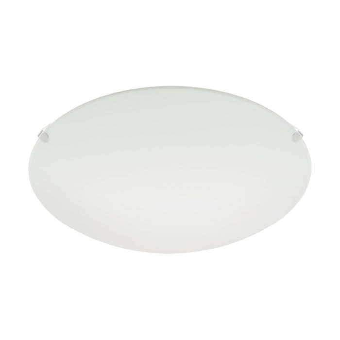
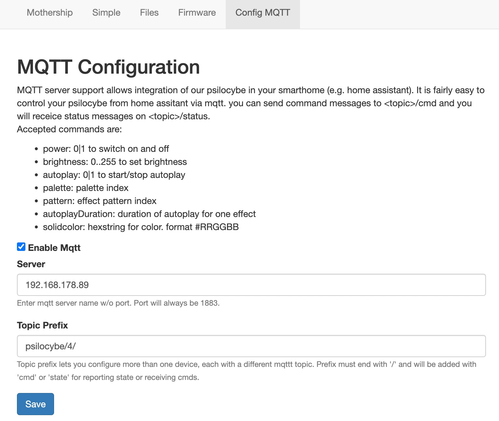

Psilocybe Lamp
=========

Control an addressable LED strip with an ESP8266 via a web browser for a Psilocbye lamp see https://www.evilgeniuslabs.org/psilocybe

Hardware
--------

Building the lamp see https://www.evilgeniuslabs.org/psilocybe it uses 241 addressable RGB leds as rings e.g. https://de.aliexpress.com/item/1005004109462341.html and a ESP device like d1 mini or similar. (https://de.aliexpress.com/item/1005003631086102.html)

To control the data line of the led rings it is recommended to use a level shifter or a driver e.g. HCT 245.

To make it nice looking the led rings should be behind a diffusor. Easiest and nice way to do this, is to reuse a regular lamp like this 
https://toom.de/p/deckenleuchte-weisssatiniert-mars/9832229 

This how it looks (Jasons video): https://youtu.be/mms5l1I2q0M

 image courtesy of jason

Firmware
--------
Firmware is a fork of Jasons initial version https://github.com/evilgeniuslabs/psilocybe but extended with some convenient addons:

- mqtt control and status for intergration in e.g. home assistant
- WifiManager for easier setup of wifi network
- OTA for easier firmware updates
- speed control for almost all effects

Build & flash
-------------
The project is built with [PlatformIO](https://platformio.org) (`platformio.ini`), target is a Wemos D1 mini (ESP8266, 4 MB).

```
pio run                               # build
pio run -e d1_mini -t upload          # flash via USB
pio run -e d1_mini_ota -t upload      # flash via OTA (ArduinoOTA, see upload_port)
```

The web UI in `web/` is embedded into the firmware at build time (`tools/embed_web.py`), so there is no
separate filesystem image: one upload updates firmware and UI together. Alternatively upload
`.pio/build/d1_mini/firmware.bin` on the *Config* page of the web UI.

WEB UI
------
The embedded webserver presents a nice UI to control the lamp. The UI is updated in realtime even if you control the device via mqtt.

- *Mothership* (`/`): all settings
- *Simple* (`/simple.htm`): on/off, patterns and colors, made for phones
- *Config* (`/config.htm`): device info (LED pin, versions, ...), MQTT settings and firmware upload

Inside an iframe (e.g. a Home Assistant webpage card) the navigation is hidden automatically; `?embed=1` / `?embed=0`
forces it off / on. Note that a Home Assistant instance served via https cannot embed the lamp's plain http page.


MQTT 
------------
The lamp implements the Home Assistant **MQTT JSON schema** light, including transitions
(e.g. used by integrations like Chameleon that fade colors).

Either enable *Home Assistant auto discovery* on the Config page, or configure it in YAML
(replace the prefix `psilocybe/psilo1/` by yours):
````
mqtt:
  light:
    - name: "Psilocybe"
      schema: json
      command_topic: "psilocybe/psilo1/set"
      state_topic: "psilocybe/psilo1/state"
      availability_topic: "psilocybe/psilo1/availability"
      brightness: true
      supported_color_modes: ["rgb"]
      effect: true
      effect_list: ["Pride", "Color Waves", "Solid Color"]   # any pattern names, see /all
      transition: true
      flash: false
````

Topics (all below the configured prefix):

- `set`: JSON command, e.g. `{"state":"ON","brightness":200,"color":{"r":255,"g":120,"b":0},"transition":2}`,
  `{"state":"OFF","transition":5}` or `{"effect":"Pride"}`. `transition` is in seconds; brightness and
  (in *Solid Color*) the color fade, effects switch immediately. A color without effect switches to *Solid Color*.
- `state`: JSON state (retained) with the Home Assistant keys `state`, `brightness`, `color_mode`, `color`,
  `effect` plus `power`, `solidColor`, `pattern`, `palette`, `speed`, `autoplay`, `autoplayDuration`.
- `availability`: `online` / `offline` (retained, last will).
- `info`: version info on connect, e.g. `{ "clientId": "Psilocybe-xxxxxx", "IP": "x.x.x.x","version":"0.3" }`.
- `cmd/<action>`: single commands, kept for compatibility:
  - power: on|off
  - brightness: 0..255
  - autoplay: 0|1
  - autoplayDuration: duration of autoplay for one effect
  - palette: palette index
  - pattern: effect pattern index
  - speed: 1..255
  - solidcolor: hexstring for color, format #RRGGBB

## MQTT config



# Other improvements
This firmware has some convenience features that were not part of the original firmware:

- **OTA firmware update**: uses ArduinoOTA library, so that firmware and web ui data can be updated directly from ArduinoIDE over the air
- **WiFiManager**: if no wifi is configured or wifi not in reach, a self service access point is started, with UI to pick wifi network and enter password
