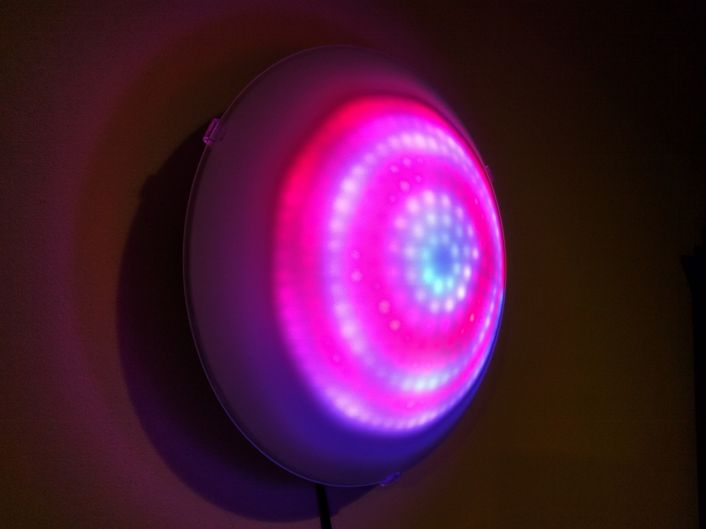
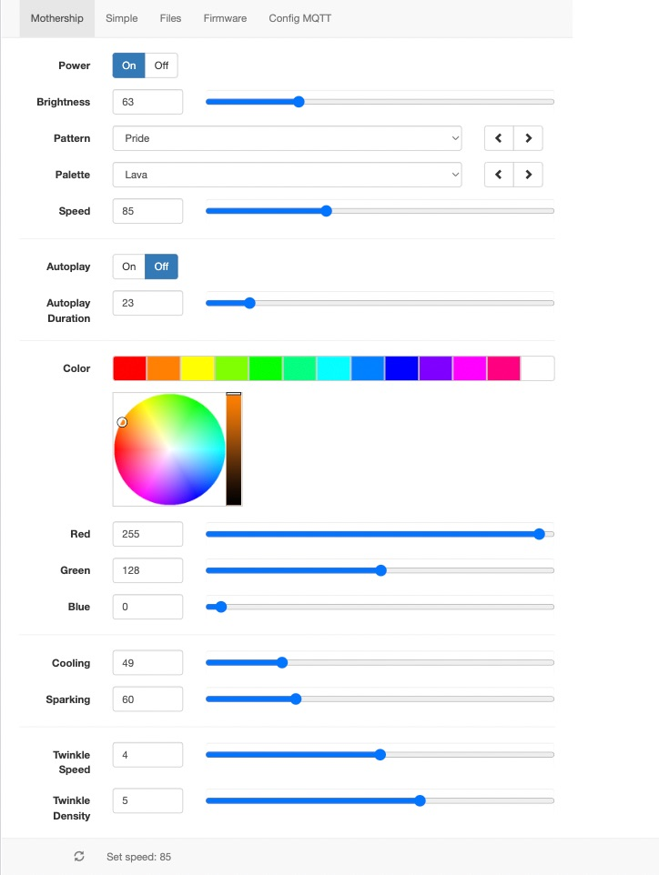

Psilocybe Lamp
=========

Control an addressable LED strip with an ESP8266 via a web browser and Home Assistant, originally made for the
Psilocybe lamp, see https://www.evilgeniuslabs.org/psilocybe

Hardware
--------

Building the lamp see https://www.evilgeniuslabs.org/psilocybe it uses 241 addressable RGB leds as rings e.g. https://de.aliexpress.com/item/1005004109462341.html and a ESP device like d1 mini or similar. (https://de.aliexpress.com/item/1005003631086102.html)

To control the data line of the led rings it is recommended to use a level shifter or a driver e.g. HCT 245.

To make it nice looking the led rings should be behind a diffusor. Easiest and nice way to do this, is to reuse a regular lamp like this 
https://toom.de/p/deckenleuchte-weisssatiniert-mars/9832229 

This how it looks (Jasons video): https://youtu.be/mms5l1I2q0M

 image courtesy of jason

The firmware also drives a plain LED strip: set the number of connected LEDs (1..241) on the *Config* page.
Linear effects (Pride, Color Waves, Twinkles, Fire, Confetti, ...) then use exactly the connected LEDs, the ring
and XY effects keep the geometry of the original lamp and show the part that is connected.

LED type WS2812B (GRB) and the power limit of 4 A are set at compile time (`psilocybe.ino`). The data pin is
selected on the *Config* page (D1, D2, D4, D5, D6, D7; default **D4**, the original ring lamp uses **D5**);
changing it restarts the lamp.

Firmware
--------
Firmware is a fork of Jasons initial version https://github.com/evilgeniuslabs/psilocybe but extended with some convenient addons:

- Home Assistant integration via MQTT (JSON schema light with transitions, auto discovery)
- web UI embedded in the firmware, made for phones, with a config page
- WifiManager for easier setup of wifi network
- OTA and browser based firmware updates
- speed control for almost all effects, palette auto rotation or a fixed palette
- configurable number of LEDs

Build & flash
-------------
The project is built with [PlatformIO](https://platformio.org) (`platformio.ini`), target is a Wemos D1 mini (ESP8266, 4 MB).

```
pio run                               # build
pio run -e d1_mini -t upload          # flash via USB
pio run -e d1_mini_ota -t upload      # flash via OTA (ArduinoOTA, see upload_port)
```

For OTA set `upload_port` in `platformio.ini` to the lamp's host name (`Psilocybe-<chip id>.local`) or IP.

The web UI in `web/` is embedded into the firmware at build time (`tools/embed_web.py`), so there is no
separate filesystem image: one upload updates firmware and UI together. Alternatively upload
`.pio/build/d1_mini/firmware.bin` on the *Config* page of the web UI. All settings are kept in the EEPROM and
survive updates.

First start: if no known WiFi is in reach, the lamp opens the access point `psilocybe`. Connect to it and pick
your WiFi network in the portal (WiFiManager).

WEB UI
------
The embedded webserver presents a nice UI to control the lamp. The UI is updated in realtime even if you control the device via mqtt.

- *Mothership* (`/`): all settings, incl. fire (cooling, sparking) and twinkle parameters
- *Simple* (`/simple.htm`): on/off, patterns and colors, made for phones
- *Config* (`/config.htm`): device info (versions, WiFi, ...), data pin and number of LEDs, MQTT settings and firmware upload



Home Assistant
--------------
The lamp is integrated via MQTT. Enter the broker and a topic prefix (e.g. `psilocybe/psilo1/`, one per lamp)
on the *Config* page and enable MQTT.

### Auto discovery (recommended)

Tick *Home Assistant auto discovery* on the *Config* page and save. The lamp then appears as a device in
Home Assistant (*Settings → Devices & services → MQTT*, named `Psilocybe-<chip id>`) with these entities:

| Entity | Type | Controls |
|---|---|---|
| (the device name) | light | on/off, brightness, RGB color, effect (all patterns), transition |
| Speed | number | animation speed 1..255 (also how fast palettes rotate) |
| Autoplay | switch | cycle through the effects automatically |
| Autoplay duration | number | seconds per effect when autoplay is on |
| Palette | select | `Auto` (palettes rotate) or one fixed palette for all palette based effects |

If the light was configured in YAML before, remove that entry first, otherwise it shows up twice. Unticking the
option removes the entities from Home Assistant again. Discovery uses the default prefix `homeassistant/`.

### Configuration in YAML

Without discovery, configure the light manually (replace the prefix `psilocybe/psilo1/` by yours):

```yaml
mqtt:
  light:
    - name: "Psilocybe"
      schema: json
      command_topic: "psilocybe/psilo1/set"
      state_topic: "psilocybe/psilo1/state"
      availability_topic: "psilocybe/psilo1/availability"
      brightness: true
      supported_color_modes: ["rgb"]
      effect: true
      effect_list: ["Pride", "Color Waves", "Solid Color"]   # any pattern names, see http://<lamp>/all
      transition: true
      flash: false
  number:
    - name: "Psilocybe speed"
      command_topic: "psilocybe/psilo1/cmd/speed"
      state_topic: "psilocybe/psilo1/state"
      value_template: "{{ value_json.speed }}"
      min: 1
      max: 255
  switch:
    - name: "Psilocybe autoplay"
      command_topic: "psilocybe/psilo1/cmd/autoplay"
      state_topic: "psilocybe/psilo1/state"
      value_template: "{{ value_json.autoplay }}"
      payload_on: "1"
      payload_off: "0"
  select:
    - name: "Psilocybe palette"
      command_topic: "psilocybe/psilo1/cmd/paletteName"
      state_topic: "psilocybe/psilo1/state"
      value_template: "{{ value_json.paletteName }}"
      options: ["Auto", "Rainbow", "Rainbow Stripe", "Cloud", "Lava", "Ocean", "Forest", "Party", "Heat"]
```

### Transitions and effects

- `transition` (seconds) fades the brightness, switching on/off and, in the effect *Solid Color*, the color.
  Integrations that fade colors (e.g. Chameleon) therefore work smoothly. Changing the effect is immediate.
- Setting a color without an effect switches the lamp to *Solid Color*; selecting an effect afterwards switches back.
- Effects with their own colors (e.g. Pride, Fire, Lava Noise, the twinkle variants) ignore the palette setting.

### Dashboard

Use the standard cards (tile, entities, light) with the entities above, they also work in the app and remotely.
The fire and twinkle parameters are only available in the web UI. The web UI can also be embedded with a
*Webpage* card: inside an iframe the navigation is hidden automatically (`?embed=1` / `?embed=0` forces it
off / on). A Home Assistant served via https cannot embed the lamp's plain http page (mixed content).

MQTT reference
--------------
Topics (all below the configured prefix):

- `set`: JSON command (Home Assistant JSON schema), e.g.
  `{"state":"ON","brightness":200,"color":{"r":255,"g":120,"b":0},"transition":2}`,
  `{"state":"OFF","transition":5}` or `{"effect":"Pride"}`.
- `state`: JSON state (retained) with the Home Assistant keys `state`, `brightness`, `color_mode`, `color`,
  `effect` plus `power`, `solidColor`, `pattern`, `palette`, `paletteName`, `speed`, `autoplay`, `autoplayDuration`.
- `availability`: `online` / `offline` (retained, last will).
- `info`: version info on connect, e.g. `{ "clientId": "Psilocybe-xxxxxx", "IP": "x.x.x.x","version":"0.7" }`.
- `cmd/<action>`: single commands:
  - power: on|off
  - brightness: 0..255
  - autoplay: 0|1
  - autoplayDuration: seconds per effect
  - palette: 0 = Auto (palettes rotate), 1..8 = fixed palette
  - paletteName: Auto, Rainbow, Rainbow Stripe, Cloud, Lava, Ocean, Forest, Party, Heat
  - pattern: effect pattern index
  - speed: 1..255
  - solidcolor: hexstring for color, format #RRGGBB

Other improvements
------------------
This firmware has some convenience features that were not part of the original firmware:

- **Firmware update**: over the air with ArduinoOTA (`pio run -e d1_mini_ota -t upload`) or by uploading the
  `.bin` on the *Config* page; firmware and web UI are always updated together
- **WiFiManager**: if no wifi is configured or wifi not in reach, a self service access point is started, with UI to pick wifi network and enter password
- **Persistent settings**: brightness, effect, color, palette, autoplay, fire parameters, number of LEDs and the
  MQTT settings and the data pin are stored in the EEPROM
